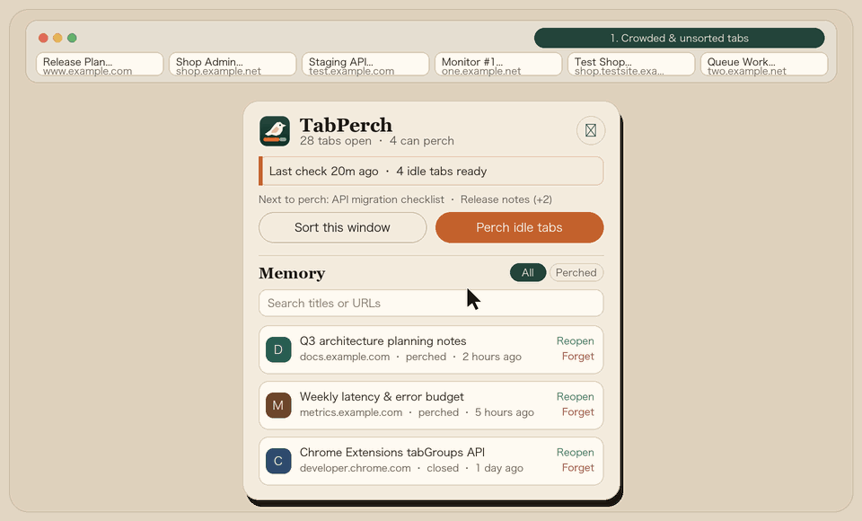

<div align="center">
  
  <h1>TabPerch</h1>
  <p><strong>A local-first Chrome extension that closes idle tabs, groups related services, and remembers every closed URL.</strong></p>
  <p>
    <a href="https://github.com/Buddruggy/TabPerch/releases/latest"></a>
    <a href="LICENSE"></a>
    
    
  </p>
  <p>
    <strong>English</strong> · <a href="docs/README.zh-CN.md">简体中文</a>
  </p>
  <br />
  
</div>

---

## Overview

Browser tabs quietly pile up during daily work: dozens of pages stay open because you might need them later, the tab strip shrinks to unreadable icons, and finding the right tab becomes a chore.

**TabPerch** keeps your browser tidy without losing context:

- **Perches idle tabs** after they go unused for a configurable period, while keeping pinned, active, audible, and allowlisted pages untouched.
- **Groups related tabs by service**, folding `www` and environment hosts (`test`, `testsite`, `dev`, `staging`) into the same service group while keeping distinct services separate.
- **Remembers closed URLs locally** on your machine so you can search, filter, or batch-restore them anytime.

---

## Installation

### Option 1: Download Release ZIP (Recommended)

1. Download [`tabperch-v0.1.0.zip`](https://github.com/Buddruggy/TabPerch/releases/latest/download/tabperch-v0.1.0.zip) from [GitHub Releases](https://github.com/Buddruggy/TabPerch/releases/latest) and unzip it.
2. Open `chrome://extensions` in Chrome and enable **Developer mode** in the top-right corner.
3. Click **Load unpacked** and select the unzipped folder.

### Option 2: From Source

```bash
git clone https://github.com/Buddruggy/TabPerch.git
```

Then open `chrome://extensions`, enable **Developer mode**, click **Load unpacked**, and select the cloned `TabPerch` directory.

> **Requirement:** Google Chrome 114 or newer (Manifest V3).

---

## Key Features

### 1. Safe Idle Tab Closing
- **Configurable idle timer:** Tabs unused for **48 hours** (default, adjustable from 1 to 720 hours) become eligible for perching.
- **Install grace period:** Tabs that were already open when you installed TabPerch start their idle clock at installation time, so nothing closes unexpectedly right after install.
- **Guardrails:** Never closes pinned tabs, the active tab, audible tabs, loading tabs, incognito tabs, or sites on your allowlist.
- **Gentle background sweeps vs. instant manual cleanup:** Background checks run every 10 minutes, closing at most **5 tabs** per pass and always keeping at least **12 tabs** open. Clicking **Perch idle tabs** in the popup closes all eligible idle tabs above your minimum in one go.
- **Live preview:** The popup previews which tabs will be perched next before you click.

### 2. Service-Aware Grouping & Accordion Tab Strip
- **Environment-aware grouping:** Tabs from the same service are grouped together even across environment subdomains. For example, `www.example.com` and `test.example.com` share one group (`example.com`), and `shop.example.net` and `shop.testsite.example.net` share one group (`shop.example.net`).
- **No false merging:** Distinct services under the same root domain—such as `one.example.net` and `two.example.net`, or `docs.google.com` and `mail.google.com`—stay in separate groups.
- **Adaptive accordion behavior:** When the tab strip gets crowded, expanding one group automatically collapses other open groups so you can read full tab titles. The crowding threshold scales with your window width (~11 visible slots on a 1500px window, ~20 on 2560px, ~30 on 4K 3840px).
- **Zero Chrome sync popups:** When a group is reduced to a single tab, TabPerch automatically ungroups that last tab so closing it never triggers Chrome's *"Delete tab group from all devices?"* confirmation dialog.

### 3. Local URL Memory & One-Click Restore
- **Automatic archiving:** Both auto-perched tabs and manually closed `http(s)` tabs are saved to local storage with their title, domain, timestamp, and close reason.
- **One-click batch undo:** Whenever tabs are perched, a **Reopen all** action in the popup restores the entire last batch at once.
- **Instant search & filtering:** Filter between **All** and **Perched** (auto-closed) entries, or search by page title and URL.

---

## Language Support (i18n)

TabPerch uses Chrome's native `_locales` internationalization system. The UI is **English** by default and automatically adapts to your browser's display language across **10 languages**:

| Locale Code | Language | Native Name |
| :--- | :--- | :--- |
| `en` | English (Default) | English |
| `zh_CN` | Simplified Chinese | 简体中文 |
| `zh_TW` | Traditional Chinese | 繁體中文 |
| `ja` | Japanese | 日本語 |
| `ko` | Korean | 한국어 |
| `es` | Spanish | Español |
| `pt_BR` | Portuguese (Brazil) | Português (Brasil) |
| `de` | German | Deutsch |
| `fr` | French | Français |
| `ru` | Russian | Русский |

All locale catalogs are verified by automated tests (`test/locales.test.js`) to ensure key and placeholder parity with English.

---

## Permissions & Privacy

TabPerch is **100% local-first**. There is no account, no remote server, no analytics, and no telemetry. All settings and remembered URLs live exclusively in `chrome.storage.local` on your computer and are removed when the extension is uninstalled. Incognito windows are completely ignored.

| Permission | Purpose |
| :--- | :--- |
| `tabs` | Read tab URLs, titles, and `lastAccessed` timestamps to detect idle tabs, sort tabs, and archive closed URLs |
| `tabGroups` | Create, color, and collapse/expand domain groups in the tab strip |
| `storage` | Persist user settings and URL memory locally in `chrome.storage.local` |
| `alarms` | Run periodic idle-tab checks every 10 minutes in the Manifest V3 service worker |

---

## Project Structure & Development

Core decision logic in `src/lib/` is written in dependency-free ES modules and tested directly with Node's built-in test runner, separate from the Chrome API glue in `src/background.js`.

```text
TabPerch/
├── _locales/              # Chrome i18n message catalogs (10 languages)
├── docs/                  # Translated documentation (README.zh-CN.md)
├── icons/                 # Extension toolbar & store icons (16/32/48/128px)
├── scripts/
│   ├── render-icons.py    # Zero-dependency supersampled icon generator
│   └── pack-release.py    # Builds clean release/Web Store zip into dist/
├── src/
│   ├── background.js      # MV3 service worker (alarms, tab & group events)
│   ├── lib/               # Pure logic (domain parsing, idle rules, archive, crowd math)
│   ├── popup/             # Toolbar popup UI
│   ├── options/           # Settings page UI
│   └── ui/                # Shared i18n, relative time, and preview helpers
├── test/                  # Node.js unit & locale parity tests
└── manifest.json          # Chrome Extension Manifest V3
```

### Commands

Requires **Node.js 20+** and **Python 3**.

```bash
# Run unit and locale parity tests
npm test

# Build a clean distribution zip in dist/tabperch-v0.1.0.zip
npm run pack

# Regenerate anti-aliased PNG icons
python3 scripts/render-icons.py
```

---

## Contributing

Issues and pull requests are welcome. Before submitting a PR, please run `npm test` to make sure all unit tests and locale checks pass.

## License

[MIT](LICENSE) © Buddruggy
