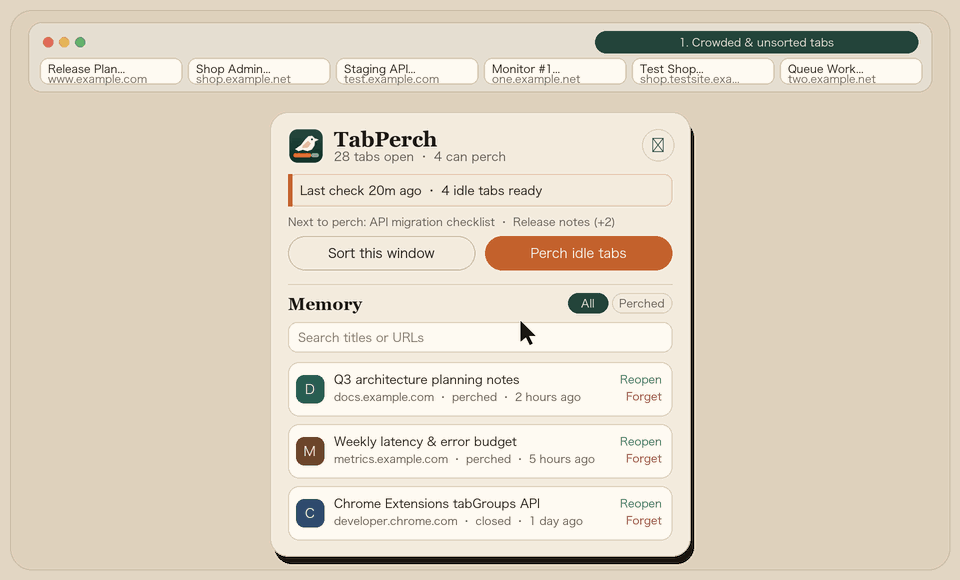

<div align="center">
  
  <h1>TabPerch</h1>
  <p><strong>本地优先的 Chrome 标签页管理扩展：自动收起闲置标签、按服务智能归组折叠、本地记忆防丢失。</strong></p>
  <p>
    <a href="https://github.com/Buddruggy/TabPerch/releases/latest"></a>
    <a href="../LICENSE"></a>
    
    
  </p>
  <p>
    <a href="../README.md">English</a> · <strong>简体中文</strong>
  </p>
  <br />
  
</div>

---

## 项目简介

日常工作中浏览器标签页常常越开越多：很多页面怕以后找不到不敢关，标签栏被挤得只剩一排小图标，找网页越来越费劲。

**TabPerch** 在不丢失任何网页记录的前提下帮你保持标签栏清爽：

- **自动收起闲置标签**：超过设定时间未访问的标签自动收起，固定、当前查看、正在播放声音及白名单网站绝不误关。
- **按服务智能分组**：自动忽略 `www` 以及 `test`、`testsite`、`dev`、`staging` 等环境子域名，把同一服务的正式环境与测试环境归入同一组，不同服务严格分开。
- **本地网址记忆**：所有自动收起或手动关闭的网页都保存在本机，支持搜索、筛选和一键批量恢复。

---

## 安装指南

### 方式一：下载 Release 压缩包安装（推荐）

1. 从 [GitHub Releases](https://github.com/Buddruggy/TabPerch/releases/latest) 下载 [`tabperch-v0.1.0.zip`](https://github.com/Buddruggy/TabPerch/releases/latest/download/tabperch-v0.1.0.zip) 并解压到本地文件夹。
2. 在 Chrome 地址栏打开 `chrome://extensions`，开启右上角的 **开发者模式**。
3. 点击左上角 **加载未打包的扩展程序**（或「加载已解压的扩展程序」），选择刚才解压出来的文件夹即可。

### 方式二：从源码加载

```bash
git clone https://github.com/Buddruggy/TabPerch.git
```

打开 `chrome://extensions`，开启 **开发者模式**，点击 **加载未打包的扩展程序** 并选择克隆下来的 `TabPerch` 目录。

> **环境要求：** Google Chrome 114 或更新版本（Manifest V3）。

---

## 核心功能

### 1. 安全的闲置标签自动收起
- **可调节闲置时长**：默认 **48 小时**未打开的标签页视为闲置（可在设置中调整为 1～720 小时）。
- **安装保护期**：刚安装扩展时已经打开的存量标签页，会从安装那一刻重新起算闲置时间，避免一装上就被大批关掉。
- **防误关保护**：固定（Pinned）标签、当前激活标签、正在发声的标签、加载中的标签、无痕窗口以及白名单域名永远不会被自动关闭。
- **温和定时巡检 + 手动一键清理**：后台每 10 分钟检查一次，单次最多收起 **5 个**，并始终保留至少 **12 个**打开的标签；手动点击弹窗中的「收起不常用的」按钮时，会在保留最少标签数的前提下一次性收干净。
- **即将收起预览**：点击按钮前，弹窗会直接展示即将被收起的标签标题列表，鼠标悬停可查看完整名单。

### 2. 按服务智能归组与自适应手风琴展开
- **自动识别测试/预发环境**：同一服务跨环境共享分组。例如 `www.example.com` 与 `test.example.com` 会合并为 `example.com` 组，`shop.example.net` 与 `shop.testsite.example.net` 会合并为 `shop.example.net` 组。
- **不同服务严格隔离**：同一根域名下的不同服务（如 `one.example.net` 与 `two.example.net`，或 `docs.google.com` 与 `mail.google.com`）各自独立成组，绝不混在一起。
- **自适应手风琴折叠**：当标签栏拥挤到看不清标题时，点开某一个折叠组会自动收起其他已展开的组，把标签栏空间让给当前组。拥挤阈值随浏览器窗口像素宽度自动缩放（1500px 窗口约 11 格、2560px 约 20 格、4K 3840px 约 30 格）。新开标签页进入分组时该分组会自动展开。
- **消除 Chrome 同步删除弹窗**：当某个分组内的标签被关到只剩 1 个时，自动将该标签移出分组，避免关闭最后一个标签时弹出 Chrome 的“要关闭该标签页并删除该分组吗”确认框。

### 3. 本地网址记忆与一键恢复
- **自动归档**：无论是由插件自动收起，还是你手动关闭的 `http(s)` 网页，都会记录标题、域名、关闭时间和原因。
- **一键批量恢复**：每次自动或手动收起一批标签后，弹窗通知栏右侧都会提供 **「全部恢复」** 按钮，点一下即可原样恢复整批标签。
- **筛选与搜索**：支持在 **「全部 / 自动收起」** 之间切换筛选，或按标题、网址实时搜索。

---

## 多语言支持 (i18n)

TabPerch 基于 Chrome 原生 `_locales` 国际化标准构建，默认使用英文，并会根据浏览器语言自动切换为以下 **10 种语言**：

| 语言代码 | 语言名称 | 本地名称 |
| :--- | :--- | :--- |
| `en` | 英语（默认） | English |
| `zh_CN` | 简体中文 | 简体中文 |
| `zh_TW` | 繁体中文 | 繁體中文 |
| `ja` | 日语 | 日本語 |
| `ko` | 韩语 | 한국어 |
| `es` | 西班牙语 | Español |
| `pt_BR` | 葡萄牙语（巴西） | Português (Brasil) |
| `de` | 德语 | Deutsch |
| `fr` | 法语 | Français |
| `ru` | 俄语 | Русский |

---

## 权限说明与隐私承诺

TabPerch 坚持 **100% 本地优先**：没有账号体系、没有后端服务器、没有任何统计或遥测上报。所有设置与网址记忆仅保存在本机浏览器的 `chrome.storage.local` 中，卸载扩展时一并清除；无痕窗口完全不介入。

| 权限名称 | 用途说明 |
| :--- | :--- |
| `tabs` | 读取标签页网址、标题与最后访问时间，用于判断闲置、排序归组和本地归档 |
| `tabGroups` | 创建、着色、折叠与展开同服务的标签组 |
| `storage` | 在本机 `chrome.storage.local` 中保存扩展设置和网址记忆 |
| `alarms` | 在 Manifest V3 后台休眠后每 10 分钟唤醒一次执行定时巡检 |

---

## 目录结构与开发指南

`src/lib/` 下的核心判定逻辑全部采用无外部依赖的纯 ES 模块编写，可直接用 Node.js 内置测试运行器测试，与 `src/background.js` 中的 Chrome API 调用解耦。

```text
TabPerch/
├── _locales/              # Chrome 官方规定的多语言文案目录（支持 10 种语言）
├── docs/                  # 多语言文档目录（README.zh-CN.md）
├── icons/                 # 扩展工具栏与商店图标（16/32/48/128px）
├── scripts/
│   ├── render-icons.py    # 零依赖超采样抗锯齿图标生成脚本
│   └── pack-release.py    # 生成用于 GitHub Release 与应用商店的 zip 包
├── src/
│   ├── background.js      # MV3 后台 Service Worker
│   ├── lib/               # 纯函数核心逻辑（域名解析、闲置判定、归档、窗口拥挤度）
│   ├── popup/             # 工具栏弹窗界面
│   ├── options/           # 设置页界面
│   └── ui/                # 界面公共模块（国际化、相对时间、预览数据）
├── test/                  # 单元测试与多语言完整性校验
└── manifest.json          # Chrome 扩展 Manifest V3 配置文件
```

### 常用命令

需要 **Node.js 20+** 和 **Python 3**。

```bash
# 运行单元测试与 10 国语言包完整性校验
npm test

# 打包生成干净的发布包 dist/tabperch-v0.1.0.zip
npm run pack

# 重新生成抗锯齿 PNG 图标
python3 scripts/render-icons.py
```

---

## 贡献与开源协议

欢迎提交 Issue 或 Pull Request。提交代码前请运行 `npm test` 确保所有单元测试与多语言校验通过。

[MIT](LICENSE) © Buddruggy
